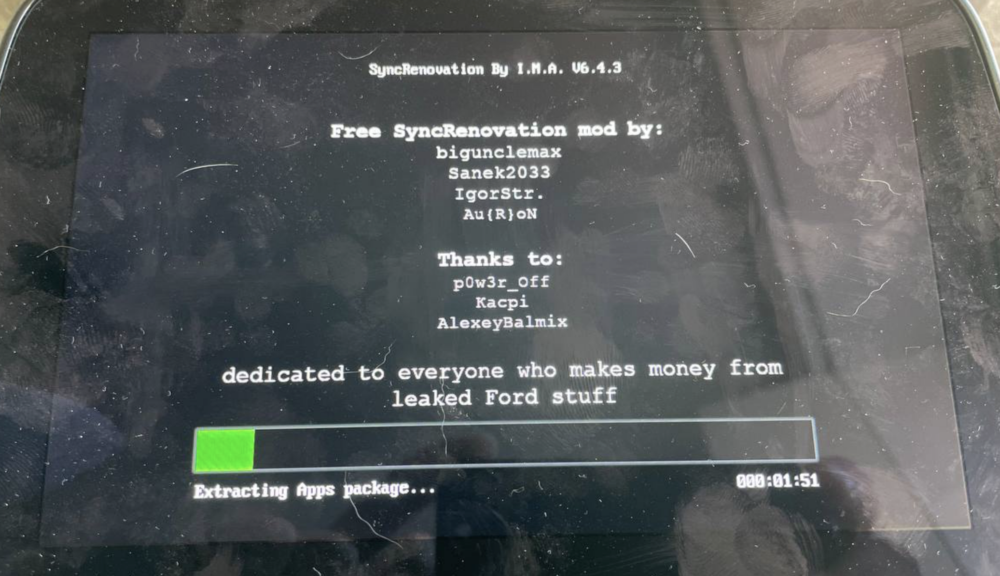

# SyncRenovation 

Rebuild Reformat-IFS for Sync 3 

[Sync3story: How we fixed a reformat](https://gist.github.com/bigunclemax/db509488879668ffb6fb7c02761a09c7)





Used tool`s 

* [MkIfs by Bigunclemax](https://github.com/bigunclemax/mkxfs)
* [sync3flash by Bigunclemax](https://github.com/bigunclemax/sync3flash)


> [!WARNING]
> Use at your own risk, you may kill and brick your device.


> [!NOTE]
> Use only ready-made IFS build files.


  
Make IFS
-----

```shell

MKIFS_PATH=./fs/ ./tools/mkifs-macos ./buildfile.bld ./repacked-01.ifs

```


Build 
------


```shell

# In MacOS (intel)

./make-ifs-macos.sh 


```


ToDo
-----

- [X] Editor / convert `/proc/boot/.script` - move to Txt  
- [X] Write tool update `buildfile.bld` - use manual, not need automation 
- [X] Support USB-Lan
- [ ] SSH Server 
- [x] Support MY20 new Display 
- [x] Support new EMMC
- [x] Support downgrade to pre-3.3.19052 firmware (`PARTITION_TYPE=A`)
- [ ] `jq` tool for read&work JSON files in sh
- [ ] More and more docs

**Add support custom** `.sh`:
- [ ] Read `/fs/usb0/path.json` 
- [ ] install before finish boot
- [ ] install before run `update_radio.sh`
- [ ] install after all install in `update_radio.sh`


## Downgrading to older firmware (`PARTITION_TYPE`)

`partition` always lays out Type B (1.5GiB) `apps`/`rwdata` partitions,
which is correct for 3.3.19052+ but leaves the eMMC mismatched from what a
pre-3.3.19052 build (e.g. 3.0.23219, Type A -- 1GiB) actually expects. Add
`PARTITION_TYPE=A` to your `reformat.lst` to use `partition_native` instead.
Leave it unset (or set `B`) and you get the same Type B layout this tool has
always produced. See [`docs/PARTITION_TYPE.md`](docs/PARTITION_TYPE.md) and
[`docs/UPDATE_PART_SIZE_GATE.md`](docs/UPDATE_PART_SIZE_GATE.md) (needed
alongside it for a Type A downgrade to actually complete) for details.

**No separate Jailbreak/Daemon install needed afterward.** `update_radio.sh`
(unmodified, stock behavior) already writes a `usb_installer.sh` watcher
into `/fs/mp/scripts/` and wires it into `startup_gf.sh` on every reformat
-- it runs on every boot and auto-executes `/fs/usb0/SyncMyMod/autoinstall.sh`
whenever a USB stick with that path is inserted. Confirmed live: right after
a reformat through this tool, a plain `SyncMyMod`-format package (no prior
JB/Daemon install) ran immediately.


## LanUSB

Default IP: `192.168.1.26`

* Support: Chip ASIX AX88772C, support by  QNX
* Vendor : 0x0b95 (ASIX Elec. Corp.)
* Product : 0x772b (AX88772C)
```
For example D-Link DUB-E100 rev.B1
```

### Telnet Password

Login `root`  
```
#Pasa3Fo
```


# Changelog

### (unreleased) `3.0-downgrade-support` branch

* Add `PARTITION_TYPE` support: `partition_native` (2-byte patch of
  `partition`, produces the pre-3.3.19052 Type A / 1GiB `apps`/`rwdata`
  layout) + `update_radio.sh`/`reformat.lst` field, Type B (unchanged
  default) unless `PARTITION_TYPE=A` is set. See `docs/PARTITION_TYPE.md`.
* Fix `update_part`'s "Image size is less than partition size" hard-reject
  -- was blocking installation of any image genuinely smaller than its
  target partition (which a correct Type A `apps.img` always is relative to
  this tool's internal expectations), even though that's a safe, valid
  layout (unused trailing space, same as a partially-empty disk). The
  overflow-safety "image bigger than partition" check is untouched. See
  `docs/UPDATE_PART_SIZE_GATE.md`.

### 2023-10-21 V6.4.3

* Successful support new display

### 2023-10-19 V6.1

* Make release `SyncRenovation By I.M.A. V6.1`
* Add log to `/fs/usb0/syncrenovation.log` from variable `$LOG_USB_FILE`
* Fix path_pre_install.sh & post install no wait file
* Back param u in `dispmon -u`, for support display

### 2023-10-19 V6 

* Make release `SyncRenovation By I.M.A. V.6`
* Support MY20 new Display: fix dispmon &  switch disp_rsrmgr and dispmon to new versions & add files graphics_l.conf,graphics_p.conf and SO libs
* Support new EMMC: `partition_SDINBDG4-64G`
* images: update
* switch `update_radio.sh` 
* update_radio.sh: add custom payload hooks
* update_radio.sh: add USB_INSTALLER installation
* Add `bzip2`
* Add `chsum`
* Add `diff`
* Add `strings`
* Add `tail`
* Add `zip unzip`

### 2023-10-13 

* Init release with QNX-REFORMAT-DEV
* Support telnet & qconn
* Support USB-LAN 

